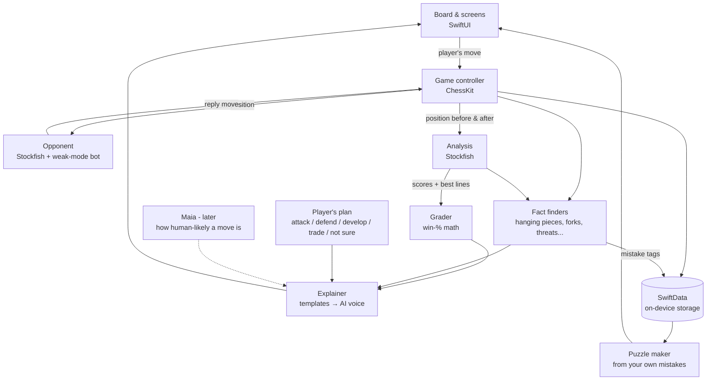

# PawnPals — Design Doc

Written in plain language on purpose: this project is also how we learn to code. Boxes marked **Why** explain the reasoning behind a choice.

---

## 1. Big picture

Everything runs **on the iPhone**: no server, no login, nothing to pay for. (The one optional exception is a cloud AI model for the coach's voice — see §4.)



> **Why:** each box does one job and hands plain data to the next. The grader never draws anything; the board never does math. That means we can test the grader without any screen — give it two numbers, check the label.

## 2. Main components

| Component | Job | Notes |
|---|---|---|
| **Board UI** | Draw the board, take taps, show highlights and arrows | Our own 8×8 SwiftUI grid. Tap-to-move (better than dragging on a phone). |
| **Game controller** | Holds the real game state; checks legality | **ChessKit** is the referee. Nothing else decides what's legal. |
| **Engine service** | Talks to Stockfish: "here's a position" → "here's the answer" | **ChessKitEngine** wraps Stockfish. Answers arrive over time, so this is `async` code. |
| **Opponent bot** | Picks the computer's move at the chosen level | Stockfish's weakest setting is still too strong for beginners, so we add our own weak mode (§5). |
| **Grader** | Turns score-before / score-after into a label | Pure math. Easy to test. |
| **Fact finders** | Small functions that each answer one question ("is a piece hanging?") | These produce the *why*. |
| **Explainer** | Turns facts into a sentence at the right level | Templates first; AI voice later. |
| **Review screen** | Key moments + step through the punishment | |
| **Storage** | Games, mistake counts, puzzles | SwiftData, on the device. |
| **Puzzle trainer** | Replays positions where you went wrong | Simple spaced repetition. |

## 3. Move grading

**Step 1 — Score the position before and after the move.** Stockfish gives a score in *centipawns* (100 ≈ one pawn ahead) or "mate in N".

**Step 2 — Convert the score to a win chance.** Being +8 vs +5 doesn't matter (you're winning either way); +1 to −2 matters a lot. So we use the same curve Lichess uses:

```
winPercent = 50 + 50 * (2 / (1 + exp(-0.00368208 * centipawns)) - 1)
```

Mate scores become ~100% or ~0%.

**Step 3 — Label the drop**, from the mover's point of view:

| Drop in win % | Label |
|---|---|
| ≤ 2 and the only good move (2nd-best is ≥ 10% worse) | **great** |
| ≤ 5 | **good** |
| 5–10 | **inaccuracy** |
| 10–20 | **mistake** |
| > 20 | **blunder** |

"Great" needs Stockfish's top **two** moves at once (a setting called MultiPV). All thresholds live in one settings file so we can tune them after real games.

> **Why win %:** a mistake is about how much it hurts your *chances*, not how many pawns of score it costs.

⚠️ **Watch out:** Stockfish reports the score from the side **to move**. After White moves, it's Black's turn, so the sign flips. Get this wrong and every move looks like a blunder. Write a test for it.

## 4. Explanations — code finds facts, AI only words them

1. **Fact finders** (Swift + ChessKit) inspect the position and Stockfish's best line, and return structured facts, e.g.
   ```json
   { "type": "hanging_piece", "piece": "knight", "square": "f3", "attackedBy": "bishop" }
   { "type": "missed_mate_in_1", "move": "Qh7#" }
   { "type": "allows_fork", "forkSquare": "c7", "targets": ["king", "rook"] }
   ```
2. **Templates** turn facts into sentences: *"Your {piece} on {square} isn't protected — their {attacker} can take it for free."*
3. **When no fact finder fires**, the coach is honest: *"The computer sees a deeper idea here — step through it to see."* Never invent a reason.
4. **AI voice (later step):** an AI model gets **only** the facts + template sentence and rewrites them in a friendlier way. Code then checks that every piece and square it mentions is in the facts; if not, we show the template instead.

**Where the AI model runs: in the cloud, behind a small proxy.**
- **Cloud model** (e.g. Claude Haiku) behind a tiny server (e.g. a Cloudflare Worker) that holds the API key. **Never put an API key inside the app.** Set a monthly spend limit.
- The template sentences always work on their own. If the network or the proxy is down, the coach falls back to them, so the AI voice is polish, never a requirement.
- *Why not Apple's on-device Foundation Models?* They need iOS 26 and an Apple Intelligence iPhone (15 Pro or newer). Our test phone is an iPhone XR, which stops at iOS 18. If we later target newer phones only, on-device becomes an option again: free, private, no server.

> **Why:** language models are great with words and bad at tracking 32 pieces — they invent illegal moves. ChessKit and Stockfish are never wrong about the board. Each tool does what it's good at.

### Coaching levels

The **grade** is the same objective math for everyone. The **coaching level** decides what to *say*:

| Rating band | Coach focuses on | How much it says |
|---|---|---|
| < 600 | Hanging pieces, free captures, mate in 1 (missed/allowed), escaping check | **One** thing per move; praise often |
| 600–1200 | Forks, pins, threats, development, castling | One or two things |
| 1200+ | Plans, deeper tactics, comparing lines | Full detail |

> **Why:** at a 300 rating, raw grades would call most moves mistakes. That's honest but crushing. A beginner needs "your queen is hanging," not five notes per move.

### Predict, then reveal

Before the grade, the player taps: ⚔️ Attack · 🛡️ Defend · 🏗️ Develop · 🔁 Trade · 🤷 Not sure.

Code checks what the move *actually did* (created a new attack? protected a piece? moved a piece off the back row? captured equal value?) and what the position *needed* (was something threatened?). Then:

- **Plan matched, good move:** "Yes — you developed your bishop, and it's a good move."
- **Plan matched, wrong moment:** "You did attack, but their queen was threatening your rook. Defending came first."
- **Plan didn't match:** "You wanted to defend, but this move doesn't protect the knight."
- **Not sure:** a gentle hint about what mattered.

### Show the punishment

For a mistake or blunder, take Stockfish's best line *after* the bad move (3–6 half-moves) and let the player step through it with ◀ ▶ on a mini board, with a running material count ("you're down a knight").

### Key moments

After the game: rank every move by its win-% swing, keep the top 3, skip any within 2 moves of one already picked. Include big **missed chances** (opponent blundered, player didn't punish it).

## 5. The opponent

- **Beginner levels (~300–1000):** our own bot. Ask Stockfish for its top several moves, then sometimes pick a worse one or deliberately leave something hanging, tuned per level. It should lose *believably*, not randomly.
- **Middle/upper levels:** Stockfish's built-in strength settings.
- **Later:** Maia as a human-like opponent from ~1100 up.

## 6. Maia (later step)

Maia is a chess AI trained on millions of real games to predict what a human **at a given rating** would play — not to win.

- **Gives us:** a human-like opponent, and "how hard was this?" ("only 8% of players at your level find this").
- **Doesn't:** judge moves (a common move can still be a blunder — Stockfish always grades), or cover very low ratings (its models start around ~1100).
- **How:** Maia models are network files for the **lc0** engine, which ChessKitEngine already supports. Design a `HumanModel` protocol now (`probabilityOfMove(position, move, rating)`) that returns "unknown" until Maia is plugged in.

## 7. Data we store (SwiftData)

```swift
Profile     { id, name, rating, opponentLevel, createdAt }
Game        { id, profile, date, pgn, result, playerColor, moves: [MoveRecord] }
MoveRecord  { ply, san, fenBefore, fenAfter, scoreBefore, scoreAfter,
              winDrop, grade, facts: [Fact], intent?, bestMove, bestLine }
MistakeStat { profile, tag /* hanging_piece, missed_fork, ... */, count, lastSeen }
Puzzle      { id, profile, fen, solution: [String], tag, sourceGame,
              timesTried, timesSolved, nextDue }
```

A **puzzle** is the position *before* the player's mistake; the solution is Stockfish's best move. We only save it if the best move is clearly better than the 2nd-best, so there's one right answer. `nextDue` = simple spaced repetition: get it right → see it later; wrong → see it sooner.

## 8. Tech stack

| Choice | Why |
|---|---|
| **Swift + SwiftUI** | The target is iPhone. Native means fast engines, Maia support, and Game Center for multiplayer later. Xcode Previews show changes as you type. |
| **iPhone only, iOS 18+** | Our test phone is an iPhone XR, whose last iOS is 18. Its A12 chip runs Stockfish easily. |
| **ChessKit** | Trusted rules referee: legal moves, check, mate, PGN/FEN. |
| **ChessKitEngine** | Stockfish (and lc0 for Maia) packaged for iOS. |
| **SwiftData** | Built-in local database. No accounts needed. |
| **Swift Testing** | Built into Xcode. For the grader and fact finders. |
| **Cloud AI model + small proxy** | The coach's friendlier voice (optional polish). The proxy keeps the API key out of the app. |
| **GPL-3.0, public repo** | Stockfish and lc0 are GPL, so our code must be open source if we ever ship. |

Running on your own iPhone needs only a free Apple ID (the install expires after 7 days — just re-run from Xcode). TestFlight / App Store needs the $99/year Apple Developer Program.

## Build plan

Each step ≈ an evening or two. Something visible from step 1.

| # | Step | You'll see |
|---|---|---|
| 0 | Install Xcode, clone this repo, create a "Hello Chess" SwiftUI app, run it on the iPhone | Your app on your phone |
| 1 | Draw the board, tap to select, show legal moves (ChessKit), pass-and-play | **A playable game** (and friends on the same phone!) |
| 2 | Move list, undo, flip board, game-over screen | A real game |
| 3 | Stockfish via ChessKitEngine + eval bar | A bar that moves as you play |
| 4 | Computer opponent with custom weak levels | Play a bot at your level |
| 5 | Grader (win-% math), test-first | Colored labels on moves |
| 6 | Beginner fact finders: hanging piece, free capture, mate in 1 | "Your queen on d4 isn't protected!" |
| 7 | Coaching levels by rating band | Gentle at 300, deeper higher up |
| 8 | Show the punishment stepper | ◀ ▶ through the opponent's answer |
| 9 | Predict-then-reveal | The coach responds to your plan |
| 10 | AI coach voice + fact check | Friendlier explanations |
| 11 | Save games, key-moments review | "3 turning points" after each game |
| 12 | Mistake tracking + "My patterns" screen | "Hung 5 pieces this week, down from 9!" |
| 13 | Puzzles from your own mistakes | Personal practice |
| 14 | Maia: human-like opponent + "your level" comments (1100+) | A bot that plays like a person |
| v2 | Game Center matches with friends | Phone vs. phone |

Steps 0–1 are the steepest: Xcode, Swift, and the board all at once. Budget 2–3 evenings for step 1.

## Hardest parts / where we'll get stuck

1. **Xcode setup & code signing** — getting the app onto the phone trips up everyone the first time. That's why it's step 0.
2. **Swift basics** — optionals (`?` and `!`) confuse beginners. Learn them while building the board.
3. **Async engine calls** — Stockfish answers over time. The opponent and the analyzer must not fight over one engine. ChessKitEngine can only run one Stockfish per app, so they share it through a queue and take turns.
4. **Score sign flips and mate scores** — see §3. Test them.
5. **"Hanging" is subtle** — attacked-but-defended, defended-but-attacked-by-a-cheaper-piece, pins. Start simple; improve later.
6. **Honest "why"** — some best moves are deep strategy no fact finder can name. Don't invent reasons.
7. **Tuning the weak bot** — it should lose believably. Expect lots of playtesting.
8. **The AI fact check** — pulling pieces/squares out of the AI's sentence to verify them.
9. **Puzzles with two answers** — only keep clear single-answer positions.
10. **Scope creep** — finish each step before adding ideas. Keep a "later" list.
